  

# 🚀 Awesome Operational Insights & Predictive Analytics 📊

> 💡 **A curated list of top Operational Insights and Predictive Analytics platforms** — featuring SaaS/hosted commercial observability and enterprise BI suites alongside production-grade open-source tools for automated anomaly detection, time-series forecasting, performance profiling, and AI-driven root-cause analysis (RCA).
>
> 🌟 *Star this repository if you find it helpful for your infrastructure, DevOps, SRE, or data science workflows!* 🌟

---

## 📑 Table of Contents

- [🌐 Sector Overview & Market Dynamics](#-sector-overview--market-dynamics)
- [🟦 SaaS / Hosted Platforms](#-saas--hosted-platforms)
- [🟩 Open-Source Software](#-open-source-software)
- [📊 Comparison Matrix at a Glance](#-comparison-matrix-at-a-glance)
- [🎯 Key Evaluation Criteria](#-key-evaluation-criteria)
- [🤝 Contributing](#-contributing)
- [💖 Support](#-support)
- [⭐ Star History](#-star-history)
- [📄 License](#-license)

---

## 🌐 Sector Overview & Market Dynamics

The global market for **AIOps, Operational Intelligence, and Predictive Analytics** was estimated at approximately **$18.5 Billion in 2024** and is projected to surpass **$65 Billion by 2032**, demonstrating an explosive Compound Annual Growth Rate (CAGR) exceeding 17%. 

The sector displays a **moderately fragmented yet consolidated top tier**: hyperscalers and legacy enterprise software giants (Microsoft, Salesforce, Cisco/Splunk, Datadog) dominate core infrastructure telemetry and executive dashboarding, while specialized high-growth players and open-source ecosystems capture specialized niches such as continuous profiling, eBPF-powered real-time root-cause analysis, and bespoke deep-learning time-series forecasting models.

---

## 🟦 SaaS / Hosted Platforms

Commercial, cloud-hosted Operational Insights and Predictive Analytics suites. The table below is sorted in descending order by **Company Scale (Valuation / Market Capitalization / Acquisition Value)**.

| Platform 🏷️ | Scale / Valuation 🏢 | Starting Pricing 💳 | Free Tier / Trial Limits 🎁 | Key Capabilities 🛠️ |
|:---|:---|:---|:---|:---|
| **[Microsoft Power BI](https://powerbi.microsoft.com/)** | ~$3.1 Trillion *(Microsoft Parent Market Cap)* | $10.00 / user / month *(Power BI Pro)* | **Free Forever Plan** *(Desktop version free for individual local modeling; Power BI service cloud sharing requires trial/pro)* / 60-day full Pro trial with 10 GB workspace storage | Enterprise BI, AI insights, automated forecasting, DAX analytics, Copilot natural-language exploration |
| **[Salesforce Tableau](https://www.tableau.com/)** | ~$310 Billion *(Salesforce Parent Market Cap)* | $15.00 / user / month *(Tableau Viewer; Creator starts at $75/mo)* | **Tableau Public** (Free forever for public workbooks) or **14-day free trial** of Tableau Cloud / Desktop with full Creator analytics capabilities | Visual analytics, predictive trends, clustering, forecasting, automated operational dashboards |
| **[Splunk](https://www.splunk.com/)** | $28 Billion *(Acquired by Cisco)* | $15.00 / GB of ingested data / month *(Workload/ingest pricing)* | **Splunk Free**: 500 MB data indexing/day forever (single-node, no clustering/alerting) / **14-day Splunk Cloud free trial** (up to 5 GB/day) | Machine data telemetry, SPL query engine, ML anomaly detection, IT service intelligence (ITSI) |
| **[Datadog](https://www.datadog.com/)** | ~$40 Billion *(Public Market Cap: NASDAQ:DDOG)* | $15.00 / host / month *(Infrastructure Pro tier; APM starts at $31/host/mo)* | **Free Forever Plan**: Up to 5 hosts with 1-day metric retention (core infrastructure collection) / **14-day full-feature free trial** with no host limit | Full-stack observability, unified logs/metrics/traces, machine learning anomaly detection, predictive forecasting alerts |
| **[Dynatrace](https://www.dynatrace.com/)** | ~$15 Billion *(Public Market Cap: NYSE:DT)* | $0.08 / hour per 8 GiB host (~$58.40 / host / month) *(Full-Stack Monitoring)* | **15-day free trial** with full Davis AI engine capabilities, automated discovery, and APM analysis | Deterministic Davis AI engine, automated topological root-cause analysis (RCA), predictive anomaly scoring |
| **[New Relic](https://newrelic.com/)** | $6.5 Billion *(Acquisition by Francisco Partners & TPG)* | $0.35 / GB ingested data beyond free tier + user seat fees *(Compute/User hybrid)* | **Free Forever Plan**: 100 GB/month data ingest free forever + 1 full-platform user seat + unlimited basic users / 30-day standard trial | Applied intelligence, proactive anomaly detection, telemetry data platform, full-stack tracing |

---

## 🟩 Open-Source Software

Production-grade, community-driven tools for metrics collection, anomaly detection, time-series forecasting, and automated root-cause analysis. Ranked in **descending order by GitHub star count** ⭐.

### 1. [Netdata](https://github.com/netdata/netdata) 
- **Tech Stack:** `C` / `Go` | **License:** `GPL-3.0`
- **Focus:** Real-time per-second infrastructure monitoring with unsupervised ML anomaly detection.
- **Highlights:** Employs zero-configuration machine learning models per metric to flag anomalies in real time with ~5% CPU and ~150 MiB RAM consumption. Supports 800+ integrations and automated alert dispatching.

### 2. [Grafana](https://github.com/grafana/grafana) 
- **Tech Stack:** `Go` / `TypeScript` | **License:** `AGPL-3.0`
- **Focus:** Multi-source operational visualization, dynamic dashboarding, and alerting analytics.
- **Highlights:** The industry-standard open visualization engine. Connects across Prometheus, Loki, OpenSearch, and SQL engines, supporting trend projections, outlier detections, and unified alerts.

### 3. [Prometheus](https://github.com/prometheus/prometheus) 
- **Tech Stack:** `Go` | **License:** `Apache-2.0`
- **Focus:** Systems monitoring, dimensional time-series data storage, and PromQL calculation engine.
- **Highlights:** The CNCF graduated telemetry backbone. Offers PromQL predictive functions such as `predict_linear()` for disk/capacity exhaustion alerts and time-series threshold forecasting.

### 4. [SigNoz](https://github.com/SigNoz/signoz) 
- **Tech Stack:** `Go` / `TypeScript` / `ClickHouse` | **License:** `Apache-2.0`
- **Focus:** Open-source full-stack APM, OpenTelemetry native backend, and distributed tracing.
- **Highlights:** High-performance ClickHouse-backed alternative to Datadog. Correlates traces, metrics, and logs with p99 latency regressions, error budget tracking, and root cause diagnosis.

### 5. [Jaeger](https://github.com/jaegertracing/jaeger) 
- **Tech Stack:** `Go` | **License:** `Apache-2.0`
- **Focus:** Distributed tracing, latency anomaly detection, and dependency graph root cause isolation.
- **Highlights:** CNCF graduated distributed tracing platform for complex microservice architectures, pinpointing cascading latency anomalies and critical path performance bottlenecks.

### 6. [OpenObserve](https://github.com/openobserve/openobserve) 
- **Tech Stack:** `Rust` | **License:** `AGPL-3.0`
- **Focus:** Cloud-native telemetry engine for logs, metrics, traces, RUM, and session replay.
- **Highlights:** Built in Rust on Apache Arrow and DataFusion with direct object store (S3/GCS/MinIO) indexing, lowering storage costs up to 140x compared to legacy Elasticsearch/Datadog clusters.

### 7. [Meta Prophet](https://github.com/facebook/prophet) 
- **Tech Stack:** `Python` / `R` / `Stan` | **License:** `MIT`
- **Focus:** Automated time-series forecasting at scale.
- **Highlights:** Optimized for operational business and infrastructure forecasting with robust handling of seasonality, holidays, structural trend shifts, and missing time-series intervals.

### 8. [VictoriaMetrics](https://github.com/VictoriaMetrics/VictoriaMetrics) 
- **Tech Stack:** `Go` | **License:** `Apache-2.0`
- **Focus:** Cost-effective, high-throughput time-series database and operational metrics monitoring.
- **Highlights:** High-density TSDB with MetricsQL, outperforming standard Prometheus retention at scale, featuring built-in anomaly detection algorithms (`vmanomaly`) for infrastructure time-series.

### 9. [sktime](https://github.com/sktime/sktime) 
- **Tech Stack:** `Python` | **License:** `BSD-3-Clause`
- **Focus:** Unified machine learning framework for time-series forecasting, regression, and anomaly detection.
- **Highlights:** Provides scikit-learn-compatible interfaces for complex time-series classification, trend decomposition, anomaly discovery, and multivariate predictive modeling.

### 10. [PyOD](https://github.com/yzhao062/pyod) 
- **Tech Stack:** `Python` | **License:** `BSD-2-Clause`
- **Focus:** Comprehensive Python library for detecting outliers and operational anomalies in multivariate data.
- **Highlights:** Includes 40+ anomaly detection algorithms spanning classical statistical methods (ECOD, COPOD), neural autoencoders, proximity-based kNN, and ensemble detectors with JIT acceleration.

### 11. [Darts](https://github.com/unit8co/darts) 
- **Tech Stack:** `Python` / `PyTorch` | **License:** `Apache-2.0`
- **Focus:** User-friendly time series forecasting and anomaly detection library.
- **Highlights:** Bridges classic statistical models (ARIMA, Exponential Smoothing) with state-of-the-art deep learning architectures (TiDE, N-BEATS, PatchTST, TFT) and integrated operational anomaly scoring.

### 12. [Coroot](https://github.com/coroot/coroot) 
- **Tech Stack:** `Go` / `ClickHouse` / `eBPF` | **License:** `Apache-2.0`
- **Focus:** eBPF-powered APM with autonomous AI root-cause analysis (RCA).
- **Highlights:** Automatically maps application architecture using zero-overhead eBPF agents, inspecting network latency, database query degradation, and memory leaks to pinpoint exact root causes.

### 13. [Nixtla StatsForecast](https://github.com/Nixtla/statsforecast) 
- **Tech Stack:** `Python` / `Numba` / `C++` | **License:** `Apache-2.0`
- **Focus:** Ultra-fast statistical and econometric time series forecasting.
- **Highlights:** Computes classic statistical models (AutoARIMA, ETS, Theta, CES) up to 20x faster than traditional implementations, engineered to forecast millions of operational telemetry series in seconds.

### 14. [Nixtla NeuralForecast](https://github.com/Nixtla/neuralforecast) 
- **Tech Stack:** `Python` / `PyTorch` | **License:** `Apache-2.0`
- **Focus:** Deep learning and foundation models for time series forecasting.
- **Highlights:** State-of-the-art neural architectures (TimeGPT, PatchTST, NHITS, Informer) designed for multivariate operational load forecasting with GPU acceleration.

### 15. [Monoscope](https://github.com/monoscope-tech/monoscope) 
- **Tech Stack:** `Go` / `S3 Storage` | **License:** `AGPL-3.0`
- **Focus:** S3-backed operational telemetry with autonomous AI anomaly detection agents.
- **Highlights:** OpenTelemetry-native platform featuring MCP (Model Context Protocol) server support for AI code agents (Claude, Cursor) to execute automated incident debugging.

### 16. [NVIDIA Kumo-TS](https://github.com/NVIDIA/Kumo-TS) 
- **Tech Stack:** `Python` / `PyTorch` | **License:** `Apache-2.0`
- **Focus:** GPU-accelerated time-series foundation models for forecasting and anomaly detection.
- **Highlights:** Developed by NVIDIA to deliver scalable deep diffusion models and transformer backbones for large-scale enterprise tabular and temporal telemetry forecasting.

### 17. [NexusBI](https://github.com/HeyderHesenov/NexusBI) 
- **Tech Stack:** `FastAPI` / `React` / `PostgreSQL` | **License:** `MIT`
- **Focus:** Natural-language conversational BI with automated "Why?" root-cause driver trees.
- **Highlights:** AI-driven platform converting plain English queries to SQL dashboards, decomposing sudden metric fluctuations into hierarchical root-cause contributor trees.

### 18. [Scry](https://github.com/tushar23560/scry-predictive-api) 
- **Tech Stack:** `Python` / `PyTorch` / `FastAPI` | **License:** `Apache-2.0`
- **Focus:** Predictive infrastructure failure classification from live metric streams.
- **Highlights:** Classifies operational states into 5 discrete conditions (`NORMAL`, `PRE_SCALE`, `PRE_FAILURE`, `ACTIVE_DEGRADATION`, `ANOMALY`) using temporal VAEs and Chronos forecasting models.

---

## 📊 Comparison Matrix at a Glance

| Software 💻 | Deployment 📦 | Anomaly Detection 🔍 | Forecasting 📈 | Root Cause Analysis 🎯 | Community / Stars ⭐ |
|:---|:---|:---:|:---:|:---:|:---:|
| **Netdata** | Self-Hosted / Cloud | ✅ Built-in ML | 🔄 Trend Checks | ❌ | ⭐ 81k+ |
| **Grafana** | Self-Hosted / Cloud | ✅ Plugins / ML | ✅ Projections | 🔄 Correlation Panels | ⭐ 77k+ |
| **Prometheus** | Self-Hosted | 🔄 Alerting Rules | ✅ `predict_linear()` | ❌ | ⭐ 67k+ |
| **SigNoz** | Self-Hosted / Cloud | ✅ Dynamic Thresholds | 🔄 Planned | ✅ Distributed Traces | ⭐ 32k+ |
| **Jaeger** | Self-Hosted | ✅ Latency Outliers | ❌ | ✅ Trace Dependency Tree | ⭐ 23k+ |
| **OpenObserve** | Self-Hosted / Cloud | 🔄 Layered / Alerts | ❌ | 🔄 Log Correlation | ⭐ 23k+ |
| **Meta Prophet** | Library (Python/R) | ✅ Residual Outliers | ✅ Bayesian Model | ❌ | ⭐ 20k+ |
| **VictoriaMetrics**| Self-Hosted / Cloud | ✅ `vmanomaly` ML | ✅ MetricsQL | ❌ | ⭐ 18k+ |
| **PyOD** | Python Library | ✅ 40+ ML Algorithms | ❌ | ❌ | ⭐ 10k+ |
| **sktime** | Python Library | ✅ Outlier Classifiers | ✅ Unified Estimators | ❌ | ⭐ 10k+ |
| **Darts** | Python Library | ✅ Ensembles | ✅ DL Models (TiDE, N-BEATS)| ❌ | ⭐ 9.5k+ |
| **Coroot** | Self-Hosted / Cloud | ✅ Telemetry Auditing | ❌ | ✅ Automated AI RCA | ⭐ 8.0k+ |
| **StatsForecast** | Python Library | ❌ | ✅ Ultra-fast AutoARIMA | ❌ | ⭐ 4.9k+ |
| **NeuralForecast**| Python Library | ❌ | ✅ Foundation Models | ❌ | ⭐ 4.3k+ |
| **Monoscope** | Self-Hosted / Cloud | ✅ AI Scheduled Agents | ❌ | ✅ LLM-Assisted RCA | ⭐ 2.1k+ |
| **NVIDIA Kumo-TS** | Python Library | ✅ Diffusion Anomaly | ✅ Transformer Forecasting | ❌ | ⭐ 64 |
| **NexusBI** | Self-Hosted | ✅ Time Series Outliers | ✅ Predictive Trend | ✅ Contributor Tree | ⭐ 3 |
| **Scry** | Self-Hosted / API | ✅ Temporal VAE | ✅ Chronos Layer | ✅ Predictive State Flag | ⭐ 0 |
| **Datadog** | SaaS Only | ✅ Unsupervised ML | ✅ Algorithmic Forecast | 🔄 Trace Correlation | Commercial |
| **Dynatrace** | SaaS Only | ✅ Deterministic AI | ✅ Capacity Planning | ✅ Davis AI Engine | Commercial |
| **New Relic** | SaaS Only | ✅ Applied Intelligence| 🔄 Trend Alerts | ✅ Automated RCA | Commercial |
| **Splunk** | SaaS / On-prem | ✅ ML Toolkit (MLTK) | ✅ Predictive SPL Queries | ✅ ITSI Event Correlation| Commercial |
| **Tableau** | SaaS / On-prem | 🔄 Clustering Outliers | ✅ Built-in Exponential | ❌ | Commercial |
| **Power BI** | SaaS / Desktop | ✅ Automated Anomaly | ✅ AI Forecast Decomposition| 🔄 Key Influencers Tree | Commercial |

---

## 🎯 Key Evaluation Criteria

When evaluating tools for Operational Insights and Predictive Analytics, consider:

1. **Detection Latency & Telemetry Ingestion Rate:** High-volume event streams (e.g., streaming logs or per-second server telemetry) require fast, zero-copy engines (Rust, Go, ClickHouse) such as OpenObserve, VictoriaMetrics, or Netdata.
2. **Root Cause Analysis (RCA) Automation:** Tools like Coroot (via eBPF) and Dynatrace (via Davis AI) map dependency graphs automatically rather than relying on manual dashboard correlations.
3. **Forecasting Horizons:** For infrastructure scaling (e.g., disk fullness, autoscaling clusters), statistical algorithms (StatsForecast, Prophet, Darts) provide deterministic confidence intervals without expensive GPU overhead.
4. **Data Ownership & Total Cost of Ownership (TCO):** High data egress and ingestion costs with proprietary SaaS tools make self-hosted, S3-backed alternatives (OpenObserve, Monoscope, SigNoz) increasingly attractive for enterprise data retention.

---

## 🤝 Contributing

Contributions are warmly welcomed! Please read our [contributing guidelines](CONTRIBUTING.md) or submit a pull request if you know of an exceptional open-source or enterprise platform that belongs here.

1. Fork this repository 🍴
2. Create your feature branch: `git checkout -b feature/cool-analytics-tool`
3. Commit your changes: `git commit -m 'Add CoolAnalytics tool'`
4. Push to the branch: `git push origin feature/cool-analytics-tool`
5. Open a Pull Request 🚀

---

## 💖 Support

Thank you for exploring and using this collection! If you find this curated list valuable for your projects, operations, or research, please consider supporting the project:

- ⭐ **Star** this repository to help others discover it.
- 🍴 **Fork** it and contribute new open-source tools or insights.
- 📢 **Share** it with your engineering team, DevOps groups, and community.
- ☕ **Buy me a coffee / Sponsor**: If you'd like to support ongoing curation and maintenance, visit the [GitHub Sponsors Dashboard](https://github.com/sponsors/ishandutta2007).

---

##  Star History

---

## 📄 License

This repository is licensed under the [Creative Commons Zero v1.0 Universal](LICENSE) (CC0 1.0) Public Domain Dedication.

---

  ⭐ <b>Star this repository if it helped streamline your observability and analytics stack!</b> ⭐

